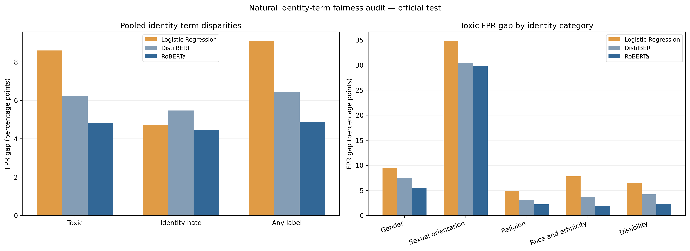
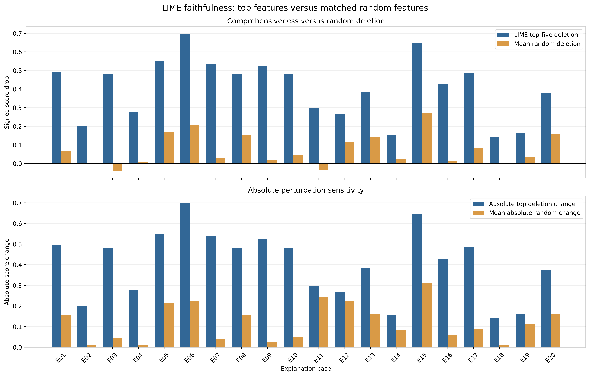

# Multi-Label Toxic Comment Classification with Explainability

NLP-04 capstone | Final research implementation and notebook documentation

**Status:** All 12 planned notebook stages (00–11) and nine core requirements documented in the master execution plan are completed. Independent human validation, original university brief cross-check, final academic report/PPT and full project backup remain pending at the research completion snapshot. This is not a deployed moderation service.

## Objective and methodology

Compare lexical and contextual classifiers across six independent toxicity labels, investigate imbalance-aware loss functions and training-data scaling, evaluate validation-selected thresholds, and audit error patterns, identity-term sensitivity and local explanations.

[Jigsaw Toxic Comment Classification Challenge](https://www.kaggle.com/c/jigsaw-toxic-comment-classification-challenge/data): toxic, severe_toxic, obscene, threat, insult, identity_hate. Of 159,571 original training rows, 32 normalized overlaps with the scored test set were removed. Group-aware development split: 127,628 training and 31,911 validation comments; representative training subset: 59,997. Official test: 63,978 fully labelled comments. No detected cross-partition ID or normalized-text overlap. TF-IDF fits only training data; transformer input is raw text with a 256-token maximum. Independent sigmoid outputs, seed 42, and BCE/weighted BCE/focal comparisons. Model selection uses validation Macro AP and per-label thresholds are frozen before official test evaluation.

## Research stages

| Stage | Scope | Status |
|---|---|---|
| 00–02 | Setup, EDA, group-aware data preparation | Complete |
| 03 | Classical ML: 11 representative configurations | Complete |
| 04–05 | DistilBERT and RoBERTa: six configurations | Complete |
| 06 | Two full-data scaling runs, optimization and freeze | Complete |
| 07 | Official test and group bootstrap | Complete |
| 08 | Quantitative errors and 180 AI-assisted annotations | Human validation pending |
| 09 | Natural and synthetic identity-term audit | Computationally complete; independent synthetic validation pending |
| 10 | 20 LIME explanations and faithfulness | Computationally complete; human interpretation review pending |
| 11 | Results, requirement matrix, deployment brief and evidence index | Complete |

## Final model and official test performance

Selected before test evaluation: `S02_ROBERTA_FOCAL_FULL_S42` (RoBERTa, focal loss, 127,628 training comments). All 19 completed configurations were evaluated under the frozen protocol. The table distinguishes validation from official test scores.

| Metric | Result |
|---|---:|
| Validation Macro AP | 0.753858 |
| Official test Macro AP | 0.685670 |
| Official test Macro ROC-AUC | 0.985466 |
| Official test tuned Macro F1 | 0.617611 |
| Official test tuned Micro F1 | 0.682986 |
| Official test Macro Precision | 0.521393 |
| Official test Macro Recall | 0.773737 |
| Exact match accuracy | 0.877458 |
| Hamming loss | 0.029284 |

Macro AP 95% group-bootstrap interval: 0.6699–0.7026; Macro F1: 0.6058–0.6289. These intervals describe fixed-model test-sample uncertainty, not training-seed variability.

[All model results](02_notebooks/11_final_documentation/results/tables/T01_final_comparison_index.csv) · [Six-label metrics](02_notebooks/11_final_documentation/results/tables/final_primary_per_label_metrics.csv) · [Frozen thresholds and workload](02_notebooks/11_final_documentation/results/tables/T03_final_thresholds_and_cost.csv) · [Paired intervals](02_notebooks/11_final_documentation/results/tables/final_paired_model_comparisons.csv)

## Main findings

- Contextual models lead observed Macro AP; the selected full-data RoBERTa leads the completed roster. Scaling improves observed AP for LR and RoBERTa, but data and optimizer-update budgets jointly change. Imbalance-aware losses improve aggregate AP over BCE for both backbones; threshold tuning does not universally improve test F1.
- Error analysis uses 180 AI-assisted diagnostic annotations, not independently reviewed human ground truth. Rare severe-toxicity precision and the validation–test gap remain important limitations.
- Fairness: 30 identity terms, five categories and 744 designed synthetic comments. Natural toxic FPR is 11.63% with monitored identity mentions vs 6.82% without (4.81 percentage points). Reduced disparity does not establish demographic fairness.
- Explainability: 20 LIME cases, 460 faithfulness evaluation records, mean local R² 0.8398. In all 20 diagnostic cases, top-feature deletion produces larger absolute score change than the mean of matched random deletions. Retained-feature prediction agreement is 85%. These diagnostics do not establish causality or representative population-level fidelity.
- Deployment proposal: human-assisted moderation. At the optimized thresholds, approximately 152.36 unique comments per 1,000 benchmark comments would be flagged, including 65.18 all-label negatives; 10.39 positives would be missed entirely. Offline GPU batched throughput is not service latency.

## Research evidence and documentation

- [Error analysis results](02_notebooks/08_error_analysis/results/tables/)
- [Fairness findings](02_notebooks/09_fairness_audit/results/tables/fairness_key_findings.csv)
- [Explainability findings](02_notebooks/10_explainability/results/tables/explainability_key_findings.csv)
- [Final requirement matrix](02_notebooks/11_final_documentation/results/tables/T02_requirement_evidence_matrix_final.csv)
- [Final deployment brief](02_notebooks/11_final_documentation/results/reports/deployment_brief_final.md)
- [Final model manifest](02_notebooks/11_final_documentation/results/configs/final_model_manifest.json)
- [Final research overview](02_notebooks/11_final_documentation/results/reports/final_research_overview.md)
- [Research limitations](02_notebooks/11_final_documentation/results/tables/research_limitations.csv)
- [Original report evidence index](02_notebooks/11_final_documentation/results/tables/report_ppt_asset_index.csv) and [public availability mapping](docs/final_evidence_publication_scope.csv)
- [Frozen research manifest](02_notebooks/06_model_optimization/results/configs/frozen_manifest.json), [registry](00_config/experiment_registry.csv) and [decision log](00_config/project_decisions.csv)

## Reproduction and privacy

See [reproduction and handoff](docs/REPRODUCIBILITY.md). This public repository is a reviewable source and evidence snapshot, not a standalone runnable model package. Raw/prepared datasets, row-level predictions, trained weights, token caches, private worksheets, individual token-level explanations, and private completion inventories remain external. The original Drive research workspace contains the complete artifacts. Notebook outputs and runtime metadata were removed from the publication copies; a private reconstruction cell was replaced by an explanatory note. The original historical evidence indexes may refer to external or withheld files. Presentation copies are not duplicated here; use their original figures. The earlier publication inventory is retained as historical evidence; see [final update inventory](docs/publication_update_inventory.csv).

## Limitations and next steps

Single seed, annotation noise, rare-label performance, truncation, uncalibrated scores, residual identity bias, and English Wikipedia domain limitations constrain generalization. The benchmark was previously familiar to the team, held out for this pipeline only. Optional S03, R01 and A01–A03 were deferred. Future changes after test freeze require fresh independent evaluation for confirmatory claims. Independent human validation is outstanding for AI-assisted error/explanation interpretations and synthetic audit intent. No state-of-the-art, demographic fairness or production readiness claim is made.

## References

- Davidson et al. (2017), *Automated Hate Speech Detection and the Problem of Offensive Language*.
- van Aken et al. (2018), *Challenges for Toxic Comment Classification: An In-Depth Error Analysis*.
- Ribeiro, Singh and Guestrin (2016), *Why Should I Trust You? Explaining the Predictions of Any Classifier*.
- Jigsaw, *Toxic Comment Classification Challenge*.
