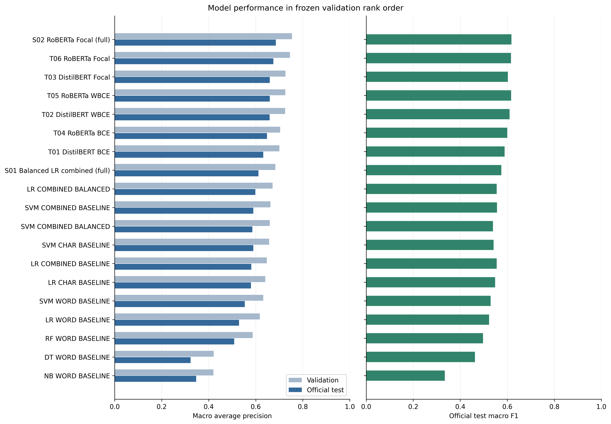

# Multi-Label Toxic Comment Classification with Explainability

NLP-04 capstone | Research milestone: model development and official test evaluation complete

**Project status:** Work in progress. Notebooks 00–07 are complete. Error analysis, identity-term fairness, LIME/SHAP and the deployment brief remain pending. This snapshot is not a completed explainability study or a production moderation system.

## Objective

Compare lexical and contextual models on six independent toxicity labels, investigate imbalance-aware loss functions and training-data scaling, and evaluate validation-selected decision thresholds on the held-out Jigsaw benchmark. The final phase will investigate errors, identity-term bias and prediction explanations.

## Dataset and protocol

[Jigsaw Toxic Comment Classification Challenge](https://www.kaggle.com/c/jigsaw-toxic-comment-classification-challenge). Six labels: toxic, severe_toxic, obscene, threat, insult, identity_hate. Of 159,571 original training rows, 32 training rows overlapping the scored test set were excluded. The group-aware development split contains 127,628 training and 31,911 validation comments. The controlled representative subset has 59,997 training comments. The official evaluation uses all 63,978 fully labelled test comments; unavailable test labels are excluded. TF-IDF fits only training data. Transformers use independent sigmoid scores, maximum length 256, and matched representative training settings for BCE, weighted BCE and focal loss. Seed 42 is used for the completed experiments. Model selection uses validation Macro AP; all six cutoffs per configuration are optimized on validation and frozen before official test inference.

## Progress

| Stage | Status |
|---|---|
| 00–02 Setup, EDA, preparation | Complete |
| 03 Classical ML (11 representative configurations) | Complete |
| 04–05 DistilBERT and RoBERTa (6 configurations) | Complete |
| 06 Full-data scaling (2 configurations), optimization and freeze | Complete |
| 07 Official test evaluation and paired group bootstrap | Complete |
| 08 Error analysis | Pending |
| 09 Identity-term fairness audit | Pending |
| 10 LIME/SHAP explanations | Pending |
| 11 Final report and deployment brief | Pending |

## Verified results

19 frozen configurations evaluated; 114 frozen thresholds; 1,000 paired normalized-text-group bootstrap draws for four key models. The primary model was selected before test evaluation: `S02_ROBERTA_FOCAL_FULL_S42`.

| Model | Training rows | Validation Macro AP | Test Macro AP | Test tuned Macro F1 |
|---|---:|---:|---:|---:|
| RoBERTa Focal (full) | 127,628 | 0.7539 | 0.6857 | 0.6176 |
| RoBERTa Focal (representative) | 59,997 | 0.7455 | 0.6751 | 0.6158 |
| DistilBERT Focal (representative) | 59,997 | 0.7263 | 0.6599 | 0.6029 |
| Balanced LR (full) | 127,628 | 0.6837 | 0.6113 | 0.5749 |
| Balanced LR (representative) | 59,997 | 0.6718 | 0.5981 | 0.5551 |

Primary test Macro ROC-AUC: **0.9855**; Micro F1: **0.6830**. Macro AP 95% interval: 0.6699–0.7026. Macro F1 95% interval: 0.6058–0.6289.

The frozen primary model leads the observed test Macro AP comparison. Both full-data scaling runs improve observed AP, but data and compute increase together. Weighted BCE and focal loss improve aggregate AP over BCE for both backbones. Threshold tuning does not universally improve held-out F1. Severe toxicity precision is a major limitation; all configurations show validation-to-test AP decline. No state-of-the-art or fairness claim is made. Bootstrap intervals characterize fixed-model test-sample uncertainty, not training-seed variability or multiplicity-adjusted comparisons.

### Evidence and figures

- [All 19 test results](02_notebooks/07_final_evaluation/results/tables/test_model_comparison.csv)
- [All per-label metrics](02_notebooks/07_final_evaluation/results/tables/test_per_label_metrics.csv)
- [Matched research comparisons](02_notebooks/07_final_evaluation/results/tables/test_matched_research_comparisons.csv)
- [Paired confidence intervals](02_notebooks/07_final_evaluation/results/tables/test_paired_bootstrap_intervals.csv)
- [Frozen manifest](02_notebooks/06_model_optimization/results/configs/frozen_manifest.json)
- [Evaluation completion manifest](02_notebooks/07_final_evaluation/results/logs/evaluation_completion_summary.json)
- [Experiment registry](00_config/experiment_registry.csv) and [decision log](00_config/project_decisions.csv)
- [F01 test model comparison](02_notebooks/07_final_evaluation/results/figures/F01_test_model_comparison.png)
- [F02 final label precision recall F1](02_notebooks/07_final_evaluation/results/figures/F02_final_label_precision_recall_F1.png)
- [F03 final binary confusion matrices](02_notebooks/07_final_evaluation/results/figures/F03_final_binary_confusion_matrices.png)
- [F04 final PR curves](02_notebooks/07_final_evaluation/results/figures/F04_final_PR_curves.png)
- [F05 default vs tuned test](02_notebooks/07_final_evaluation/results/figures/F05_default_vs_tuned_test.png)
- [F06 paired CI](02_notebooks/07_final_evaluation/results/figures/F06_paired_CI.png)

## Repository organization

- `00_config/` — canonical project settings, 19-run registry and methodology decisions.
- `02_notebooks/` — 14 notebooks through stage 07, with selected original tables and figures in their stage-owned results directories.
- `03_src/` — evaluation utilities and executed stage scripts.
- `01_data/` — small metadata manifests only, where included; no datasets or split membership lists.
- `docs/` — publication inventory, reproduction instructions and artifact scope.

## Reproduction and handoff

Read [reproduction instructions](docs/REPRODUCIBILITY.md) before executing notebooks. The full original Drive workspace is required for exact checkpoint replay. Raw datasets, prepared datasets, fitted vectorizers, trained weights, token caches and row-level predictions are intentionally external. Their fingerprints remain in the source manifests. This repository is a reviewable source/evidence snapshot, not a standalone pretrained inference package. The notebooks have their outputs removed; the original aggregate results and figures remain separately available. Additional training experiments are deferred and must be reported as exploratory after the frozen test evaluation.

## References

- Davidson et al. (2017), *Automated Hate Speech Detection and the Problem of Offensive Language*.
- van Aken et al. (2018), *Challenges for Toxic Comment Classification: An In-Depth Error Analysis*.
- Jigsaw, *Toxic Comment Classification Challenge*.

## Limitations

- Single training seed; comparisons exploratory with respect to training variability.
- Validation used for checkpoint selection and threshold tuning; development metrics are not independent test estimates.
- Full-data scaling changes both data and optimization budget.
- Historical S02 execution policy unavailable for exact matching.
- Official benchmark previously examined by the team; held out for this pipeline only.
- Scores not established as calibrated probabilities.
